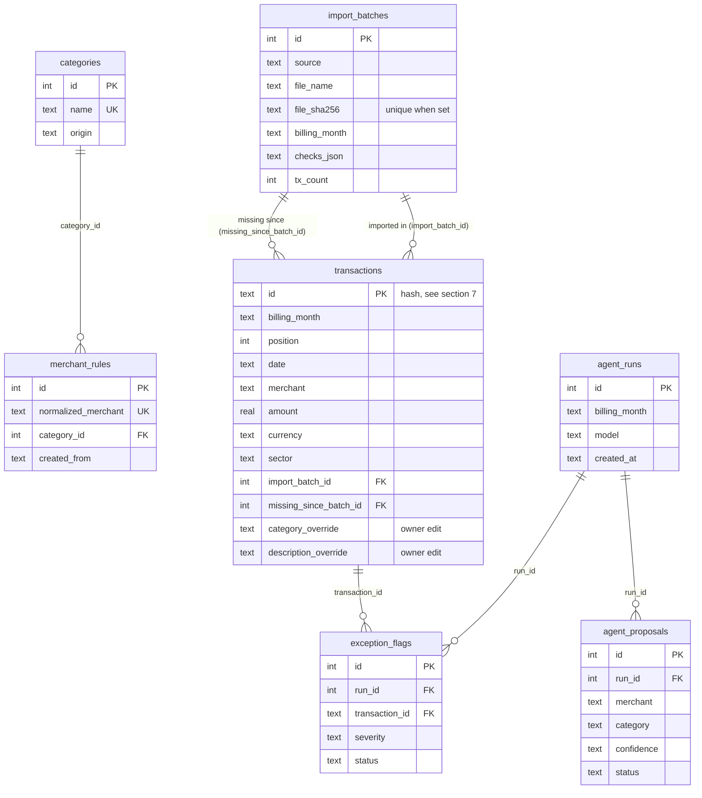

# Architecture

This document has two clearly separate parts:
- **Part A: Original architecture** is the CLI as it was before the dashboard (verified against commit `ce8c87d`). Kept for reference.
- **Part B: Target architecture** is the local dashboard. **M1 and M2 are built** (React + read API, SQLite, imports). Sections still marked *(M3+)* are planned, not built.

The detailed module-by-module assessment is in [`milestones/milestone-0-assessment.md`](milestones/milestone-0-assessment.md).

---

## Part A: Original architecture (before M1)

A TypeScript CLI run with `tsx`. All state was plain files under `data/`.

```
                 ┌──────────── src/cli.ts ────────────┐        ┌────────── src/agent/*.ts ──────────┐
 Cal website ──► │ fetch  → scraper.ts                 │        │ run.ts  (npm run agent)            │
 Cal xlsx/csv ─► │ import → statement-import.ts        │        │   merchants.ts + candidates.ts     │
                 │           └► normalize.assignIds    │        │   → loop.ts (Messages API, tools)  │
                 │ report / annual                     │        │   → handlers.ts → proposals JSON   │
                 │   → categorize.ts → report.ts       │        │ approve.ts (readline)              │
                 └──────────────┬──────────────────────┘        │   → review.decide() → rules/memory │
                                │                               └───────────────┬────────────────────┘
                                ▼                                               ▼
                         src/store.ts  ◄─────────────────────────────────────────┘
                                │   (the only module that touches the filesystem)
                                ▼
 data/transactions/YYYY-MM.json   data/rules.json (committed)   data/memory.md
 data/proposals/YYYY-MM.json      data/reports/*.md             data/raw/*.json   data/evals/*.json

 src/eval/run.ts  ── reuses prompt.ts, tools.ts, handlers.ts, loop.ts with empty rules/history/memory
```

**Layers today**
| Layer | Files | Character |
|---|---|---|
| Input | `scraper.ts`, `statement-import.ts`, `normalize.ts` | Network/file reading at the edge. Mapping and parsing are pure and tested. |
| Domain | `categorize.ts`, `candidates.ts`, `report.ts`, `agent/merchants.ts`, `agent/review.ts` | Pure functions |
| Agent | `agent/loop.ts`, `agent/tools.ts`, `agent/handlers.ts`, `agent/prompt.ts`, `agent/client.ts` | Loop is pure with an injected client. `client.ts` has import-time side effects. |
| Persistence | `store.ts` | Sync `fs`, JSON/MD files |
| Entry points | `cli.ts`, `agent/run.ts`, `agent/approve.ts`, `agent/propose.ts`, `agent/hello.ts`, `eval/run.ts` | Top-level scripts: `process.argv`, `console.log`, `process.exit` |

---

## Part B: Target architecture (M1–M2 built, M3+ planned)

### Overview

```
 Browser ── http://localhost:5173 ──► Vite dev server (apps/web, React)
                                         │  proxy /api/*
                                         ▼
                                 Express 5 on 127.0.0.1:3000 (apps/api)
                                         │  thin routes: validate → call core → JSON
                                         ▼
          src/  (existing core: categorize, report, candidates, agent loop, review.decide, import, scraper)
                                         │
                                         ▼
          src/store.ts  the seam every caller uses
              ├─► src/db/  SQL + row ↔ type mapping  ──►  data/app.db (SQLite, gitignored)
              └─► files: data/memory.md, data/raw/, data/reports/

 CLI (npm run fetch/import/report/agent/approve/eval) ──► the same src/ functions
```

### Folder structure

The existing `src/` is **not moved**. *(M3+)* marks what doesn't exist yet.

```
cal-expence-agent/
  CLAUDE.md
  README.md
  package.json            # root: CLI scripts + npm workspaces + `npm run dev`
  tsconfig.json           # include: ["src"]; each app has its own tsconfig
  apps/
    web/                  # Vite + React + React Router
      index.html
      vite.config.ts      # dev proxy /api → http://127.0.0.1:3000
      src/
        main.tsx  App.tsx  api.ts (the only file that calls fetch)  format.ts  index.css
        hooks/            # useApi, useSelectedMonth
        pages/            # Dashboard, Transactions, Imports, NotFound; Review, Rules (M3+)
        components/       # Layout, MonthGate, MonthPicker, CategoryTable, TransactionsTable,
                          # SourceBadge, Stat, ImportHistory, ScrapePanel
    api/                  # Express 5
      src/
        app.ts            # createApp(deps): middleware + routes (thin)
        server.ts         # wires the real core, listen(3000, "127.0.0.1")
        jobs.ts           # in-memory background jobs
        app.test.ts
  src/                    # the core
    db/                   # index (open, migrate, transactions), transactions, rules, proposals,
                          # imports, migrate-json + migrate/export scripts, migrations/NNN_*.sql
    imports.ts            # import services: importStatement, fetchMonth
    store.ts              # the seam: same functions as before, backed by SQLite + files
    agent/  eval/  ...
  data/                   # everything personal is gitignored
    app.db                # SQLite
    rules.json            # backup export (npm run export), gitignored
    rules.example.json    # committed: categories + fake rules for a fresh clone
    memory.md  raw/  reports/  evals/
  docs/
    product-vision.md  architecture.md  roadmap.md
    milestones/milestone-0-assessment.md  milestone-1.md … milestone-5.md
```

### Component responsibilities
| Component | Owns | Must not |
|---|---|---|
| `apps/web` | Screens, routing, form state, calling `/api` | Do category math, totals, or approval policy. Never see secrets. |
| `apps/api` | HTTP, input validation, job tracking, wiring core + db | Contain business rules (it calls `src/`) |
| `src/` core | Parsing, ids, categorization, report math, candidates, agent loop, approval policy | Know about HTTP or React |
| `src/db/` | SQL and mapping rows ↔ core types (`Transaction`, `Rule`, …) | Contain business rules |
| CLI scripts | Arguments and terminal output | Contain logic the API also needs |

### 1. How React talks to Express
- JSON over REST, same origin in dev thanks to the Vite proxy (`/api` → `127.0.0.1:3000`), so there's no CORS setup.
- Types: the API returns the core types (`CategorizedTransaction`, `Summary`, `CategoryProposal`). `apps/web` imports **types only** from `src/` (`import type`), so there's one definition and no runtime coupling.
- Endpoints:
  - Built: `GET /api/months`, `GET /api/months/:month/summary` (`summarize()` + the previous month), `GET /api/months/:month/transactions`
  - Built: `GET /api/imports`, `POST /api/imports?name=&month=` (the file is the raw `application/octet-stream` body, no multipart library), `POST /api/scrape {month}` → `202 {jobId}`, `GET /api/jobs/:id`
  - *(M3)* `GET /api/transactions?month=&q=&category=&source=`, `PATCH /api/transactions/:id`, `/api/rules`, `/api/categories`
  - *(M4)* `POST /api/agent-runs` → job id, `GET /api/proposals?status=pending`, `POST /api/proposals/:id/answer`

### 2. How the agent is invoked *(M4)*
- Extract the body of `src/agent/run.ts` into a function, for example `runAgent({ month, transactions, history, rules, memory, client, model })` that returns `{ proposals, flags, usage, stoppedBy }`. It uses the same `merchantsToReview`, `findCandidates`, tools, `SYSTEM_PROMPT`, `createHandlers` and `runLoop`.
- `npm run agent` becomes a thin wrapper (load data → `runAgent` → print → save), and the API route does the same but saves to SQLite.
- `agent/client.ts`: build the Anthropic client lazily (a `getClient()` function) so importing the module in the API or tests has no side effects. The key is read from `process.env` on the server only.
- Watch out: `client.ts` calls `process.loadEnvFile()` with no path, which reads `.env` from the working directory. The API runs in `apps/api`, so it must load the root `.env` by path, as `apps/api/src/server.ts` already does. This bug broke scraping from the dashboard once.
- A run takes several seconds, so it runs as a background job (see 3). The UI polls `GET /api/jobs/:id`.

### 3. How the scraper runs
- `fetchMonth()` in `src/imports.ts` (Puppeteer, about 30 s) runs inside the API process as an **in-memory job** (`apps/api/src/jobs.ts`): `POST /api/scrape {month}` returns a `jobId` right away, and the UI polls every 2 s. Only one scrape runs at a time (`409` with the running job's id otherwise).
- Then `mapScrapedAccounts()` → a new import batch in SQLite. Raw output still goes to `data/raw/` for debugging.
- The UI tolerates a short outage while polling (e.g. `tsx watch` restarting the API) and says so plainly when a restart lost the job.
- Credentials come from `.env` on the server. The UI never asks for them.
- There's no queue library. One process plus a `Map<jobId, Job>` is enough for one user. Jobs are lost on restart, which is acceptable.

### 4. CLI and app side by side
- Both are thin entry points over the same `src/` functions. Import and fetch already moved out of `cli.ts` into `src/imports.ts` (`importStatement`, `fetchMonth`), which **return** results that the CLI prints and the API sends as JSON. `approve.ts`'s apply-actions block follows in M4.
- **Shared storage:** the CLI and the dashboard both read and write SQLite through `store.ts`, so they always agree.
- SQLite in WAL mode lets the CLI and a running API use the DB at the same time.

### 5. SQLite and the existing data models
- `src/types.ts` stays the domain model. `src/db/` maps rows ↔ `Transaction` / `Rule` / `RulesFile`, so `categorize(transactions, rules)` keeps taking the same arguments.
- `store.ts` is the seam: the same function names (`loadTransactions`, `loadRules`, `addRules`, `saveProposals`, …) get a SQLite implementation. Callers barely change.
- **Driver (decided in M2):** built-in `node:sqlite` (`DatabaseSync`). It has no native build step and no dependency, in the same spirit as `process.loadEnvFile`. On Node 22.22 it prints an *ExperimentalWarning* on every command, which is expected. All SQL lives in `src/db/`, so switching to `better-sqlite3` (an almost identical sync API) would touch only that folder.
- The database opens on first use (`store.ts`), never at import time, with `foreign_keys = ON`, WAL mode and a 5 s busy timeout.
- Migrations: numbered `.sql` files in `src/db/migrations/` plus a `schema_version` table, applied on open, each in a transaction. Never edit one that has run; add the next number. No ORM.

### 6. Avoiding duplicate business logic
- Categorization stays computed: rule → Cal sector → null, plus (new) a manual override and the approved agent proposal stored on the transaction. Totals always come from `summarize()`.
- The approval policy has a single source: `decide()` in `src/agent/review.ts`. The dashboard's Approve button and the CLI `approve` both call one `applyAnswer()` that runs `decide()` and writes the resulting actions.
- The UI never re-implements totals or category priority. It displays what the API returns.

### 7. Imports and deduplication
- Each import (xlsx, csv, scrape, JSON migration) creates an **import batch** row: source, file name, file SHA-256, billing month, statement-total checks, row count (`importBatch` in `src/db/imports.ts`).
- The same file hash → "already imported": nothing changes, and the API answers `200` instead of `201`.
- Transactions are **upserted by id**: re-importing a month never duplicates rows, and the owner's edits (`category_override`, `description_override`, `override_source`) are never overwritten.
- **The latest import decides the month's rows.** A stored row the new batch doesn't have gets `missing_since_batch_id`: kept (edits included), but left out of `loadTransactions`, reports and the month list. If a later import has it again, the mark is cleared.
- **Transaction id (changed in M2, risk R1):** `sha1(date|merchant|amount|currency|billingMonth|installmentNumber|occurrence)`, first 12 hex characters. Installment payments share a purchase date and amount, so the billing month and payment number tell them apart. It's the same for xlsx and scraper, so the two sources still match. On real data: 376 rows had 372 unique old ids, and 376 new ones.

### 8. Preserving the evals
- `src/eval/` stays unchanged and keeps using `prompt.ts`, `tools.ts`, `handlers.ts` and `loop.ts`. Once `runAgent()` exists, the eval may call it with empty rules/history/memory, which is the same no-leakage rule.
- `dataset.ts` builds cases from `listMonths`/`loadTransactions` and `loadRules`. Those kept their signatures when they moved to SQLite in M2, so the eval works unchanged (`npm run eval` lists the same 36 cases).
- Fake-model loop tests and `review.test.ts` are untouched. A refactor counts as done only when `npm test` passes unchanged.

### 9. Configuration and secrets
- One `.env` at the repo root. The CLI loads it with `process.loadEnvFile()` from the root. The API loads it **by path**, because it runs with `apps/api` as its working directory. Optional keys: `API_PORT` (default 3000) and `DB_PATH` (default `data/app.db`; tests use `:memory:`).
- No `VITE_*` secrets. Vite only exposes `VITE_`-prefixed variables to the browser, and none are needed.
- Gitignored: `data/app.db*` and `data/rules.json`, along with the other personal data.
- Express binds to `127.0.0.1`. A Host check rejects DNS rebinding, and an Origin check rejects writes from other websites.

### 10. One dev command
- npm workspaces (`apps/web`, `apps/api`) + `concurrently` in the root: `npm run dev` → `vite` + `tsx watch apps/api/src/server.ts`.
- `tsx watch` restarts the API whenever a file it imports changes, including files in `src/`. A scrape running at that moment is lost.

### Database strategy (built in M2; recurring tables in M5)

Source of truth: `src/db/migrations/001_initial.sql` and later numbered files.

| Entity | Purpose | Important fields | Relations / constraints | Where |
|---|---|---|---|---|
| `import_batches` | One row per import or scrape | `id`, `source` (xlsx/csv/scraper/json-migration), `file_name`, `file_sha256`, `billing_month`, `checks_json`, `tx_count`, `created_at` | `UNIQUE(file_sha256)` where not null | SQLite |
| `transactions` | Every card transaction | `id` (stable hash, see §7), `billing_month`, `position` (order in the statement), `date`, `merchant`, `normalized_merchant`, `amount`, `currency`, `original_amount`, `original_currency`, `type`, `installment_number`, `installment_total`, `sector`, `memo`, `card`, `source`, `import_batch_id` → batches, `category_override`, `description_override`, `override_source` (manual/agent), `updated_at`, `missing_since_batch_id` → batches (migration 002) | PK `id`; index (`billing_month`, `position`), (`normalized_merchant`) | SQLite |
| `categories` | Allowed categories | `id`, `name`, `created_at`, `origin` (seed/owner) | `UNIQUE(name)` | SQLite (seeded from `rules.json`, or `rules.example.json` on a fresh clone) |
| `merchant_rules` | Exact merchant → category | `id`, `merchant`, `normalized_merchant`, `category_id` → categories, `created_from` (seed/approve/manual), `created_at` | `UNIQUE(normalized_merchant)` | SQLite. `npm run export` writes a gitignored `rules.json` backup |
| `agent_runs` | One agent execution | `id`, `billing_month`, `model`, `stopped_by`, `iterations`, `input_tokens`, `output_tokens`, `created_at` | | SQLite |
| `agent_proposals` | A proposed category | `id`, `run_id` → runs, `merchant`, `category`, `confidence`, `reason`, `new_category_idea`, `status` (pending/approved/changed/new_category/noted/skipped, plus `answered`: reviewed, how not recorded), `answer_json`, `answered_at` | `UNIQUE(run_id, normalized_merchant)` | SQLite (replaces `data/proposals/*.json` and its `reviewed[]`) |
| `exception_flags` | A flag the agent raised | `id`, `run_id`, `transaction_id` → transactions, `severity`, `explanation`, `reasons_json`, `status` (pending/ok/noted) | `UNIQUE(run_id, transaction_id)` | SQLite |
| `recurring_definitions` *(M5)* | Salary, rent, … | `id`, `name`, `kind` (income/expense), `amount`, `currency`, `category_id`, `schedule` (monthly day N), `start_month`, `end_month`, `match_merchant` | | SQLite |
| `recurring_occurrences` *(M5)* | One expected instance | `id`, `definition_id`, `month`, `expected_amount`, `override_amount`, `matched_transaction_id`, `status` | `UNIQUE(definition_id, month)` | SQLite |
| Memory notes | Fuzzy context for the prompt | one line per note | | **Stays `data/memory.md`** |
| Raw scraper output, failure screenshot | Debugging | | | **Stays files** (`data/raw/`) |
| Reports | Markdown output | | | **Generated on demand** from `summarize()`. Files only for the CLI. |
| Eval results | History of eval runs | | | **Stays files** (`data/evals/`) |

**Effective category** of a transaction *(M3)*, computed in code and not stored twice: `category_override` → matching rule → Cal `sector` → null. Its **source** is `manual`/`agent` → `rule` → `cal` → none. This extends `categorize()`, which already returns `categorySource`.

**Tables and their foreign keys** (as built; recurring tables come in M5):


`schema_version` (which migration files have run) has no relations. GitHub renders this diagram; in VS Code, use the "Markdown Preview Mermaid Support" extension.

### React learning plan

The user knows Angular and TypeScript. Keep the stack small and add libraries only when their pain is felt.

| Concept | Where it's introduced | Angular analogy |
|---|---|---|
| Function components + JSX + props | M1: layout, table, badges | Components with `@Input()`; templates become JSX expressions |
| `useState`, `useEffect` | M1: month picker, fetching | Component fields + `ngOnInit` / lifecycle |
| Custom hooks (`useApi`) | M1 | A small injectable service + observable |
| Composition (`children`, render props) | M1: `Card`, `Table` | Content projection (`ng-content`) |
| React Router (`<Routes>`, `useParams`, `useSearchParams`) | M1 | Angular Router; query params for filters |
| Controlled forms | M3: edit transaction, rule form | Reactive forms, minus the framework |
| Lifting state, Context (once) | M3/M4: selected month, toast | A shared service with DI |
| Server-state caching | Optional in M3/M4 (TanStack Query) | RxJS + `shareReplay` caching |

**Dependencies (M1):** `react`, `react-dom` (the library), `react-router` (routing), `vite` + `@vitejs/plugin-react` (dev server/build, JSX). API side: `express` (5). Later and optional: `@tanstack/react-query` (only if hand-written fetching gets painful), `concurrently` (one dev command). No state-management library (Redux/Zustand), no form library and no UI kit at the start. Plain CSS (or CSS modules) is enough.

### Local execution model
- Dev: `vite` on `localhost:5173` and `tsx` running Express on `127.0.0.1:3000`, with the proxy between them.
- Personal use doesn't need a production build. Optionally Express can later serve `apps/web/dist` so only one process runs.
- Long tasks (scrape, agent run) are in-process background jobs.

### Security considerations
- Loopback bind; Host-header check (DNS rebinding); Origin check on writes plus non-simple content types on POST (CSRF from other websites); no CORS needed (proxy); no auth (single local user, explicitly excluded).
- Secrets only in `.env`, read by the server; never returned by any endpoint; error messages sanitized (the scraper error must not echo credentials).
- Untrusted text (merchant names and memos) is escaped by React by default. Never use `dangerouslySetInnerHTML`. It's still treated as data in prompts (existing injection evals).
- Upload limits: accept only `.xlsx/.xls/.csv`, with a size cap. Parse in memory, and never write to a user-supplied path.
- The DB file and every personal data file are gitignored.

### Migration from JSON (done in M2)
- `npm run migrate` (`src/db/migrate-json.ts`) imports `data/transactions/*.json` as `json-migration` batches, with every id recalculated by the new scheme. It also imports `rules.json` → categories + rules, and `data/proposals/*.json` → runs/proposals/flags, translating old ids and turning `reviewed[]` into a status.
- It runs as one transaction, it's safe to re-run (by file hash and run time), and it checks row counts and totals per month against the JSON. The JSON files are only read, never changed or deleted.
- On real data: 376 rows in 4 months, all ✓; a second run added nothing.
- **Decided:** `rules.json` is no longer committed, because the repo is public and the file held real merchant names. It's still in git history; removing it from there would mean rewriting history, which wasn't done.
